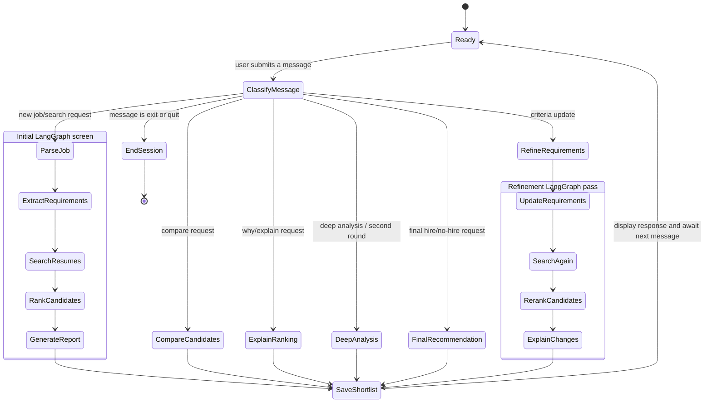

# Conversation State Machine

The diagram shows how the terminal and Streamlit chat interfaces route user
messages. A new search enters the LangGraph screening workflow. Follow-up
requests use the saved shortlist until the user starts a new search or ends
the session.

Conversation state is held in application memory. The CLI keeps it in a local
variable, while Streamlit keeps it in the current browser session. It is not
persisted between process restarts.
